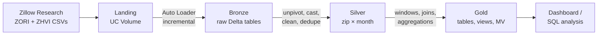

# Austin Housing Lakehouse

An end-to-end data engineering project on **Azure Databricks** that turns raw Zillow housing data into analytics-ready tables answering a practical question: **where in Texas does it make more sense to rent, and where to buy?**

Built with a medallion architecture (bronze → silver → gold) on Unity Catalog, using Auto Loader, PySpark, Spark SQL, Delta Lake, views, and materialized views.

---

## Architecture



| Layer | Objects | Purpose |
|---|---|---|
| **Landing** | `landing.raw` volume | Raw files exactly as downloaded |
| **Bronze** | `zori_raw`, `zhvi_raw` | Exact copy of source, loaded incrementally with Auto Loader |
| **Silver** | `zori_tx`, `zhvi_tx` | Clean, typed, deduplicated: one row per ZIP per month (Texas) |
| **Gold** | `rent_trend_zip`, `rent_value_zip`, `v_austin_rent_drops`, `mv_metro_monthly_rent` | Business-ready metrics for analysis and dashboards |

---

## Key findings

> _Replace with your results (queries below). Use the latest month in the data._

**Best Austin ZIPs for renters (highest price-to-rent ratio)**

| ZIP | City | Rent | Home value | Price-to-rent |
|---|---|---|---|---|
| | | | | |

**Biggest year-over-year rent drops in Austin**

| ZIP | City | Rent | YoY change |
|---|---|---|---|
| | | | |

**Austin vs. Houston: average rent trend** — _add chart screenshot here_

<!--
Queries used:

-- Price-to-rent, latest month, Austin
SELECT zip, City, rent, home_value, price_to_rent
FROM housing_dev.gold.rent_value_zip
WHERE Metro LIKE 'Austin%'
  AND month = (SELECT MAX(month) FROM housing_dev.gold.rent_value_zip)
ORDER BY price_to_rent DESC
LIMIT 5;

-- Biggest YoY rent drops
SELECT * FROM housing_dev.gold.v_austin_rent_drops ORDER BY yoy_pct LIMIT 5;
-->

**Price-to-rent ratio** = home value ÷ (monthly rent × 12). Higher means homes are expensive relative to rents (renting looks favorable); lower means buying or investing looks favorable.

---

## What's inside

### Bronze: incremental ingestion
- **Auto Loader** (`cloudFiles`) with checkpointing for exactly-once file processing and `availableNow` triggers
- **Schema hints** to keep ZIP codes as strings and preserve leading zeros (`08701` would otherwise become `8701`)
- `_rescued_data` column captures values that don't fit the schema

### Silver: cleaning and reshaping
- **Unpivot** from wide format (one column per month) to long format (`zip, month, value`)
- Type casting, null handling, filtering, and **deduplication on the table grain** `(zip, month)`

### Gold: analytics
- **Window functions** (`lag`, `dense_rank`) for month-over-month and year-over-year rent change
- **Joins** of rent and home values on `(zip, month)`, with inner vs. left join validation of row counts
- **View** for always-current results; **materialized view** for precomputed aggregates queried repeatedly

### Engineering practices
- **Unity Catalog** three-level namespace (`catalog.schema.table`) with managed tables and volumes
- **Git folders** with feature branches and pull requests

---

## Tech stack

Azure Databricks · Unity Catalog · Delta Lake · Auto Loader · PySpark · Spark SQL · Serverless compute · GitHub

---

## Repo structure

```
├── README.md
└── src/
    └── Housing        # bronze ingestion, silver transforms, gold outputs
```

---

## Roadmap

- [x] Bronze ingestion with Auto Loader
- [x] Silver transformations and gold metrics
- [x] Git workflow (branches, pull requests)
- [ ] Lakeflow Spark Declarative Pipeline with data quality expectations
- [ ] Lakeflow Job: monthly scheduled refresh with retries and dependencies
- [ ] Declarative Automation Bundle with dev/prod targets, deployed via Databricks CLI
- [ ] Governance: grants, row filters, and column masks
- [ ] Performance: Liquid Clustering, Spark UI analysis
- [ ] AI/BI dashboard

---

## Data source

[Zillow Research](https://www.zillow.com/research/data/): Zillow Observed Rent Index (ZORI) and Zillow Home Value Index (ZHVI), ZIP-code level. Raw data files are not included in this repo; download them from the link above.

---

## About

Built by **Sanju Easow** as hands-on preparation for the **Databricks Certified Data Engineer Associate** exam, combining data engineering with a background in real estate and analytics.
